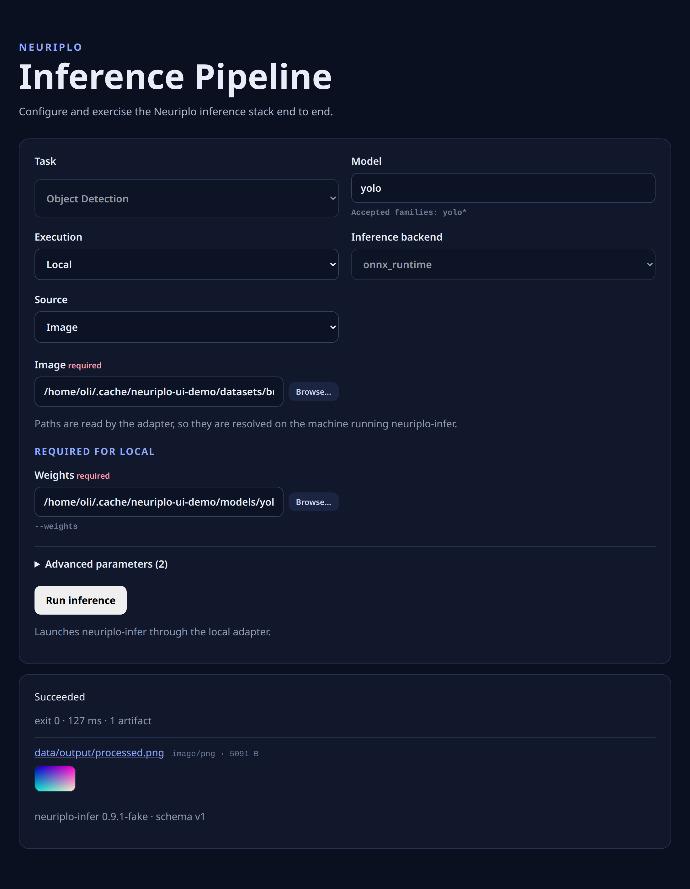
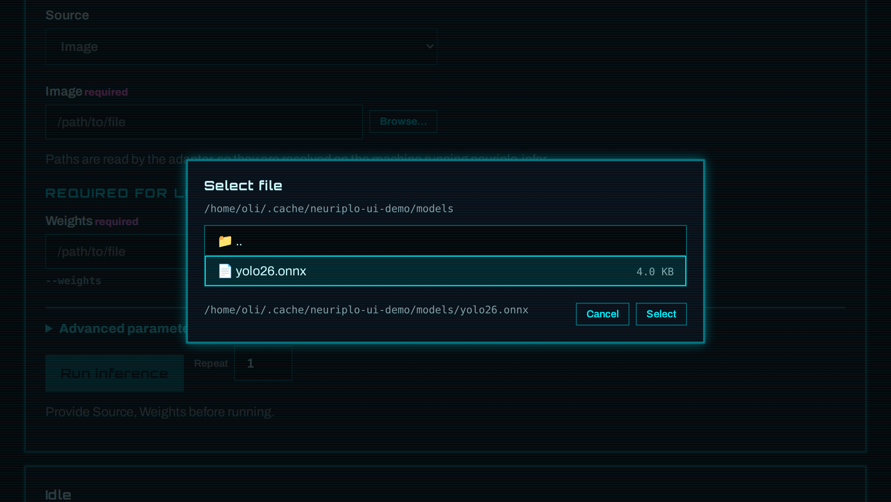

# Neuriplo UI

Web UI and end-to-end test harness for the Neuriplo inference pipeline.

The UI discovers tasks, models, backends, workflows, sources, and advanced
parameters from `neuriplo-infer --capabilities`; the frontend does not hard-code
them.

[Watch the three-minute demo on YouTube](https://youtu.be/PxTmKY71Jhc):
backend selection, processed results, and client-server inference.



## Features

- Run local or client-server inference from the browser.
- Inspect results, producer timings, logs, artifacts, and the exact command.
- Browse paths on the adapter machine for sources and weights.
- Retain, repeat, and compare runs in the current browser session.
- Exercise the workflow with Playwright.

## Repositories

Neuriplo is split across independently versioned repositories:

| Repository | Role |
| --- | --- |
| [neuriplo-ui](https://github.com/olibartfast/neuriplo-ui) | Web interface, local API adapter and browser tests. |
| [neuriplo-infer](https://github.com/olibartfast/neuriplo-infer) | C++ executable that runs local and client-server inference. |
| [neuriplo](https://github.com/olibartfast/neuriplo) | Inference backend integrations. |
| [neuriplo-tasks](https://github.com/olibartfast/neuriplo-tasks) | Task contracts, preprocessing, postprocessing and model export tools. |
| [videocapture](https://github.com/olibartfast/videocapture) | Image/video capture and output writing. |
| [neuriplo-kserve-client](https://github.com/olibartfast/neuriplo-kserve-client) | KServe V2 HTTP/gRPC client used by the inference application. |
| [neuriplo-kserve-runtime](https://github.com/olibartfast/neuriplo-kserve-runtime) | Optional KServe-compatible model server. |
| [nert](https://github.com/olibartfast/nert) | Experimental first-party ONNX inference runtime. |
| [neuriplo-platform](https://github.com/olibartfast/neuriplo-platform) | Architecture, compatibility sets and ecosystem documentation. |

The inference application pins its C++ dependencies; their version numbers do
not need to match. The UI discovers the capabilities compiled into that application.

## Install the complete application

On Ubuntu 24.04 x86_64, [download the installer](https://raw.githubusercontent.com/olibartfast/neuriplo-ui/master/install.sh)
in your browser, or use:

```bash
curl -fsSL https://raw.githubusercontent.com/olibartfast/neuriplo-ui/master/install.sh -o install.sh
```

Choose a native installation or Docker; no existing checkout, Git or Node setup
is required:

```bash
# Native: install dependencies, build and start.
bash install.sh --style native --backend onnx_runtime --start

# Or Docker: provision Docker if needed, build and start.
bash install.sh --style docker --backend onnx_runtime --start
```

Open **http://127.0.0.1:5173**. Each command installs the web app, its Node
runtime, the released C++ components and the selected backend SDK. No separate
manual installation of those dependencies is needed. Supply your own model
weights and inputs in `~/Neuriplo`.

Select `openvino`, `tensorrt`, `executorch`, `opencv_dnn` or `nert` with
`--backend`. TensorRT requires NVIDIA hardware and a working host driver; the
installer can provision a missing driver with `--install-driver` (then reboot).
See the [installation guide](docs/Installation.md) for launchers, workspace
selection, client-server configuration and platform/profile validation limits.

## Developer quick start

```bash
npm install
export NEURIPLO_INFER_BIN=/path/to/neuriplo-infer
npm run dev
```

The web app and adapter bind to `127.0.0.1`. To expose the UI proxy deliberately,
set `NEURIPLO_UI_HOST=0.0.0.0`. The web app proxies `/api` to
`http://127.0.0.1:5174` by default; change it with `NEURIPLO_UI_API`.

Useful commands:

```bash
npm run lint       # Check formatting, lint, and import order
npm run format     # Apply formatting and lint fixes
npm run typecheck  # Type-check the UI, adapter, and E2E harness
npm test           # Run unit tests
npm run build      # Build both applications
npm run test:e2e   # Run the Playwright browser matrix
```

The optional `.devcontainer/` includes the browsers and system libraries needed
by Playwright. You must still provide `neuriplo-infer`, weights, and any runtime.

## How it works

The local adapter validates the producer's capability contract, validates run
requests against it, and starts `neuriplo-infer` with an argument array. Each run
gets an isolated working directory. The response includes the exit code, wall
time, output, command, artifacts, and any structured result.

When advertised by the producer, versioned run reports supply per-stage timings
and failure attribution. Missing measurements are not inferred. The duration in
the run header is whole-process wall time, not inference latency.

The file picker reads the adapter machine's filesystem because browser file
inputs do not provide usable local paths and weights should not be uploaded for
each run.



Run history is browser-only and resets on reload. Comparisons show values side
by side without computing winners or speedups. Repeats run sequentially and
report count, minimum, median, and maximum for compatible configurations.

For client-server workflows, the adapter can inspect KServe V2 server and model
metadata. Remote hosts default to loopback and must be allowed explicitly with
`NEURIPLO_UI_REMOTE_ALLOW`; redirects are disabled and responses have timeout
and size limits.

## Adapter configuration

| Variable | Purpose |
| --- | --- |
| `NEURIPLO_INFER_BIN` | Required path to `neuriplo-infer`. |
| `NEURIPLO_UI_RUN_ROOT` | Per-run directory root; defaults to `neuriplo-ui-runs` under the system temporary directory. |
| `NEURIPLO_UI_RUN_TIMEOUT_MS` | Run timeout; defaults to `300000`. |
| `NEURIPLO_UI_SOURCE_ROOT` | Refuse source paths outside this directory. |
| `NEURIPLO_UI_BROWSE_ROOT` | Confine the file picker to this directory. |
| `NEURIPLO_UI_REMOTE_ALLOW` | Allowed remote `host` or `host:port` values, comma-separated; defaults to loopback. |
| `HOST`, `PORT` | Adapter address; defaults to `127.0.0.1:5174`. |

## End-to-end tests

```bash
npm run test:e2e
```

The suite starts its own adapter, web app and fixture remote. It refuses to
reuse an existing service, which could be configured with a different runtime.
If the default ports are in use, select free ports, for example:

```bash
NEURIPLO_UI_WEB_PORT=5480 NEURIPLO_UI_API_PORT=5481 \
  NEURIPLO_UI_REMOTE_PORT=5482 npm run test:e2e
```

With a real executable configured, `test:e2e` runs the provenance gate first.
Without one, it runs fixture tests only and does not validate a real stack.

By default, Playwright builds both apps and uses the fixture producer in
`e2e/fixtures/producer/`, so no model or weights are required. Test a real binary
with:

```bash
NEURIPLO_INFER_BIN=/path/to/neuriplo-infer npm run test:e2e
```

Provide real inputs as needed:

| Variable | Purpose |
| --- | --- |
| `NEURIPLO_UI_E2E_IMAGE` | Image source for image-based tasks. |
| `NEURIPLO_UI_E2E_VIDEO` | Video source. |
| `NEURIPLO_UI_E2E_WEIGHTS` | Weights for path-typed parameters. |
| `NEURIPLO_UI_E2E_ENDPOINT` | Client-server endpoint. |
| `NEURIPLO_UI_E2E_RUNTIME` | Built `neuriplo-kserve-runtime` to start for remote tests. |
| `NEURIPLO_UI_E2E_REMOTE_MODEL` | Model selector for the full client-server round trip. |
| `NEURIPLO_UI_BROWSE_ROOT` | Browse and source root containing the assets above. |

Failures leave traces, screenshots, videos, and server logs under
`e2e/test-results/output/`.

## Repository layout

```text
apps/web/     React and TypeScript UI
apps/server/  Local API adapter
e2e/          Playwright tests and fixture producer
specs/        Mission, stack, and design notes
```

## Build provenance for validation

Before real inference or browser validation, run:

```bash
export NEURIPLO_INFER_BIN=/path/to/build/app/neuriplo-infer
npm run validate:stack
```

The gate also blocks a UI checkout missing commits from current remote master
and records the UI commit and source hashes alongside the runtime evidence.

The gate verifies clean release sources, independent infer/core/tasks versions,
linked libraries and the executable against a recorded clean build. An existing
binary without provenance is blocked. Configure released sources and record a
fresh build with `npm run validate:stack -- --rebuild`; never attest an old binary.
Re-run the gate after build, dependency, checkout or executable changes. The
browser adapter must use the exact verified executable hash.

Sources are staged as symlinks in each private run directory so source-relative
outputs, including optical flow, remain discoverable. Input symlinks are excluded
from artifact listings and downloads.
